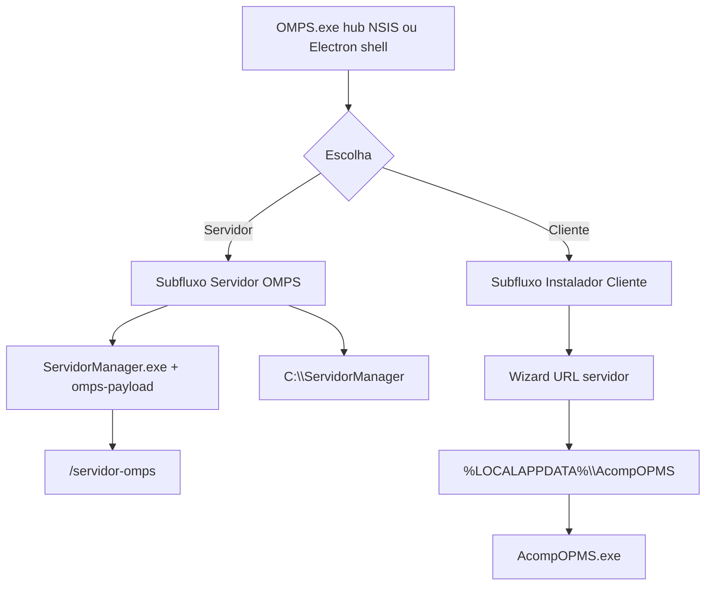

# OMPS.exe — plano do instalador unificado (Etapa 6/6)

Documento de **preparação** após auditoria de `Instalador OPMS/` e da variante **Servidor OMPS**.  
**Não** gera NSIS final, **não** altera `servidor.exe` genérico nem move `Instalador OPMS/`.

---

## Auditoria — OMPS Cliente (`Instalador OPMS/`)

### Executável gerado hoje

| Artefato | Onde |
|----------|------|
| **Instalador (wizard)** | `AcompOPMS-Instalador-<versão>-win-x64.exe` (portable Windows) |
| **App instalado** | `%LOCALAPPDATA%\AcompOPMS\AcompOPMS.exe` |

Build: `Instalador OPMS/instalador` → `npm run build:win` → saída em `instalador/dist/`.  
CI: `.github/workflows/build-instalador-opms.yml` (repo OMPS), artefato `AcompOPMS-Instalador-win-x64`.

### Independência de GitHub

- **Runtime:** sim — o wizard copia Electron + app `cliente/` de `resources/payload/` (gerado por `prepare-payload.mjs` a partir do código local). Não há clone Git no fluxo de instalação.
- **Build:** o workflow CI usa checkout do repositório; distribuição ao usuário é o `.exe` portable.

### Arquivos e dependências que acompanham o instalador

1. **`prepare-payload.mjs`** — monta `instalador/resources/payload/`:
   - `payload/electron/` — runtime Electron (`node_modules/electron/dist`)
   - `payload/app/` — `cliente/` (`electron-main.mjs`, `preload.cjs`, `lib/`, `package.json`)
2. **Portable electron-builder** — empacota wizard + payload (`asarUnpack: resources/payload/**`).
3. **Opcional:** `connection.json` (VPN WireGuard) importado no wizard.

### Endereço do servidor

1. Usuário informa **URL** (ex.: `http://192.168.x.x:8080/login`) no wizard.
2. `normalizeStartUrl` + `resolveStartUrlFromServer` consultam `{origin}/server-connection.json` quando possível.
3. Gravação: `%LOCALAPPDATA%\AcompOPMS\acomopms-desktop.config.json` com `startUrl`, `discoverConnection`, `windowTitle`.
4. Override: env `ACOMOPMS_START_URL`.

### appId, instalação, atalhos, atualização

| Item | Valor |
|------|--------|
| **appId (wizard)** | `br.marinha.acompopms.instalador` |
| **productName** | `AcompOPMS Instalador` |
| **Tipo** | **Portable** (não NSIS Add/Remove clássico para o wizard) |
| **Pasta cliente** | `%LOCALAPPDATA%\AcompOPMS` |
| **Atalho** | Desktop **AcompOPMS** (opcional, padrão ligado) via PowerShell |
| **Atualização** | Reexecutar instalador portable; pasta anterior → `AcompOPMS.old-<timestamp>` |
| **Versão wizard** | `instalador/package.json` → `1.0.8` |

---

## Auditoria — OMPS Servidor (repo Servidor)

| Item | Valor |
|------|--------|
| **NSIS intermédio** | `Servidor OMPS.exe` (`electron-builder.servidor-omps.yml`) |
| **appId** | `com.servidor.omps` |
| **Binário** | `ServidorManager.exe` + `resources/omps-payload` + `omps-bundle` |
| **Dados** | `C:\ServidorManager\` |
| **First-run UI** | `/servidor-omps` (payload local, sem Git) |
| **Genérico** | `servidor.exe` / `com.servidor.manager` — **não misturar** |

Payload servidor **exclui** `Instalador OPMS/` (`omps-payload-spec.mjs`).

---

## Conflitos identificados

| Área | Risco | Mitigação proposta |
|------|--------|-------------------|
| **appId / ARP** | Três produtos (genérico, servidor OMPS, cliente, hub) | Hub `com.servidor.omps.unified`; manter desinstaladores **separados** por componente instalado |
| **Electron duplo** | Manager Electron 35.x vs Instalador 34.x | Não fundir um único app.asar; **subpacotes** ou execução encadeada |
| **NSIS vs portable** | Servidor = NSIS; Cliente = portable | Hub NSIS com **componentes opcionais** ou wizard hub que **spawn** sub-instaladores já validados |
| **Dados** | `C:\ServidorManager` vs `%LOCALAPPDATA%\AcompOPMS` | **Sem colisão** — preservar separação |
| **Portas** | Manager 47831/5199 vs cliente (browser 8080 LAN) | Sem colisão direta |
| **Atalhos** | “Servidor OMPS” / “AcompOPMS” / “Servidor Manager” | Nomenclatura explícita por escolha no hub |
| **Tamanho do artefato** | Servidor + payload + cliente Electron | OMPS.exe = hub; ou download sob demanda — **fase 2** |

**Conclusão:** integração **viável** sem mover `Instalador OPMS/`, desde que OMPS.exe seja **orquestrador** (escolha + subfluxos), não um único electron-builder monolítico.

---

## Arquitetura recomendada

### Apresentação da escolha (fase implementação)

1. **Página inicial:** “Instalar OMPS Servidor” / “Instalar OMPS Cliente” (mutuamente independentes; permitir só uma por execução).
2. **Servidor:** atalho pós-install “Servidor OMPS” → launcher NoElectron; primeira execução guia `/servidor-omps` (já implementado).
3. **Cliente:** reutilizar UI `instalador/ui/` (URL, connection.json, atalho AcompOPMS).

### Garantia “somente componentes correspondentes”

- NSIS **componentes** `Section` / `!ifdef` ou hub que extrai **apenas** `release/servidor-omps/` **ou** executa wizard cliente embutido.
- Contrato em `scripts/omps-unified-product-spec.mjs` (`OMPS_UNIFIED_COMPONENTS`).

### Preservação do cliente independente

- Manter build CI `build-instalador-opms.yml` e portable standalone.
- OMPS.exe unificado **opcional** para distribuição; não substituir obrigatoriamente o portable atual até validação.

---

## Entregáveis desta etapa (repo Servidor)

| Artefato | Função |
|----------|--------|
| `docs/OMPS-INSTALADOR-UNIFICADO.md` | Este plano |
| `scripts/omps-unified-product-spec.mjs` | Contratos appId, paths, componentes |
| `electron-builder.omps-unified.yml` | Rascunho config (não ligado a `npm run package`) |
| `scripts/validate-omps-unified-product-config.test.mjs` | Testes anti-conflito |

---

## Hub implementado (orquestrador)

| Item | Caminho |
|------|---------|
| UI + Electron | `omps-hub/` |
| Prepare bundle | `npm run prepare:omps-unified-subinstallers` |
| Build dir (sem NSIS final obrigatório nesta fase) | `npm run package:omps-unified:dir` |
| Subinstaladores | `release/omps-unified-bundle/subinstallers/` |

**Servidor:** o hub inicia `Servidor OMPS.exe` (NSIS) se presente no bundle.  
**Cliente:** inicia `AcompOPMS-Instalador-*-win-x64.exe` (portable existente).

Prepare exige `release/servidor-omps/win-unpacked`; NSIS servidor e portable cliente podem ser gerados antes (`package:servidor-omps`, `build:omps-client-installer`).

## Bloqueios restantes (antes de OMPS.exe NSIS em produção)

1. **NSIS final do hub** — `npm run package:omps-unified` (NSIS) após validação em VM.
2. **Pipeline CI** — encadear builds servidor + cliente + prepare + hub.
3. **Assinatura / SmartScreen** — mesma política do Manager.
4. **Testes E2E** — VM limpa: hub → subinstaladores (sem misturar dados).
5. **Atualização** — política distinta por componente.

Instalação real via subinstaladores: **aguardam autorização explícita**.

---

## Distribuição final (Etapa 8/8)

| Item | Caminho / comando |
|------|-------------------|
| **Pasta de distribuição** | `release/omps-unified/` |
| **Instalador servidor** | `Servidor OMPS.exe` (cópia de `release/servidor-omps/`) |
| **Instalador cliente** | `OMPS Usuario.exe` (cópia de `release/omps-usuario/`) |
| **Manifesto** | `omps-unified-distribution.json` (SHA256 dos dois artefatos) |
| **Consolidar** | `npm run package:omps-unified-dist` |

O **hub** (`Instalar OMPS.exe`) permanece em `release/omps-hub/` para testes e compatibilidade (`npm run package:omps-hub`). **Não** é ponto de entrada obrigatório da distribuição.

**Cliente produção:** NSIS `OMPS Usuario.exe` (rede fixa). Wizard portable `AcompOPMS-Instalador-*` permanece em `build:omps-client-installer` (legado/dev).
